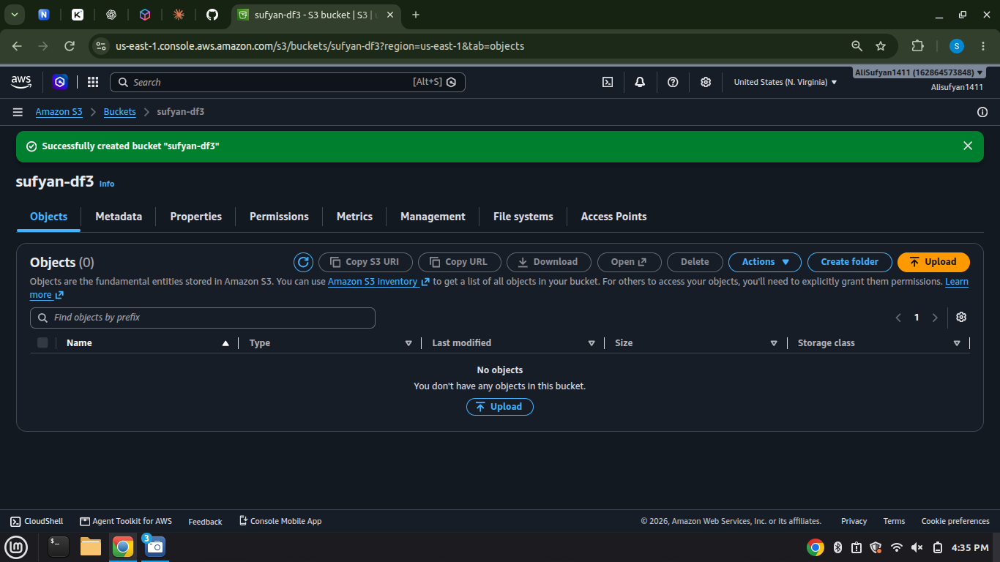
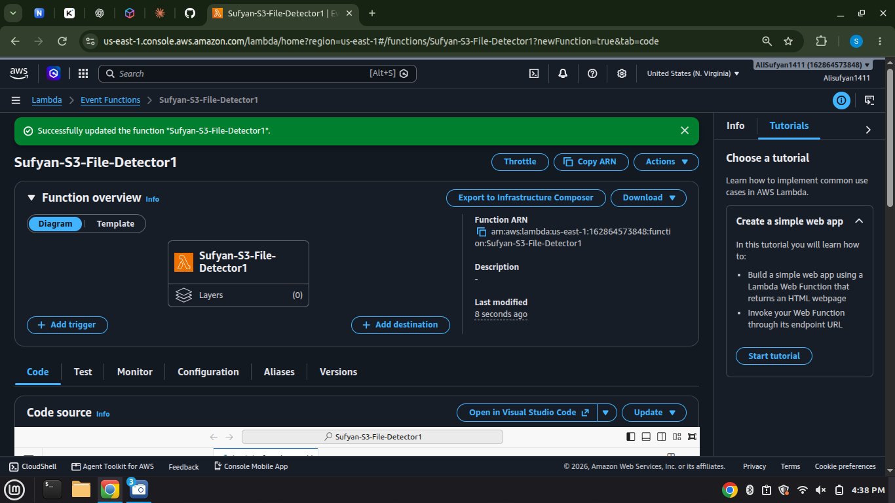
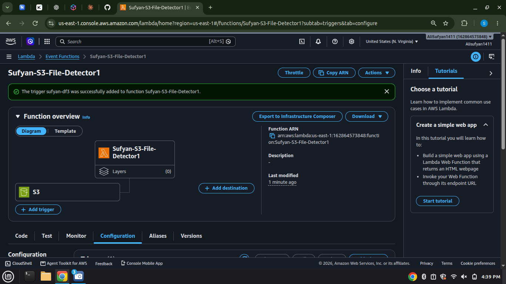
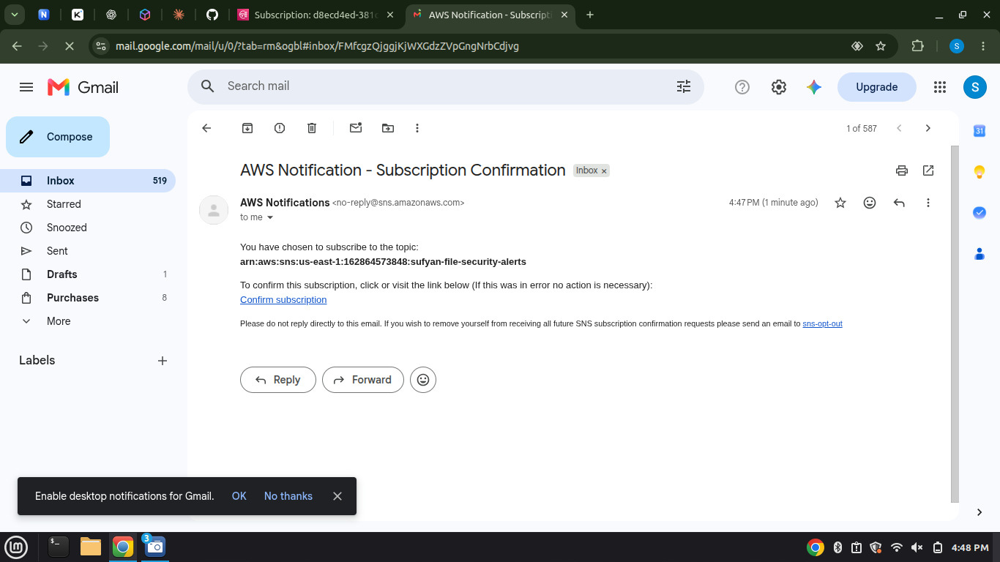
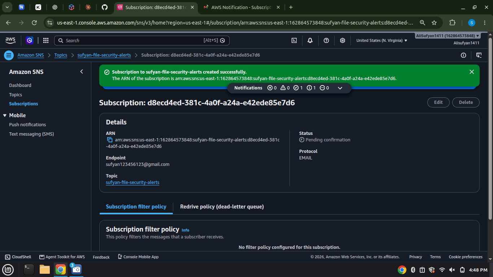
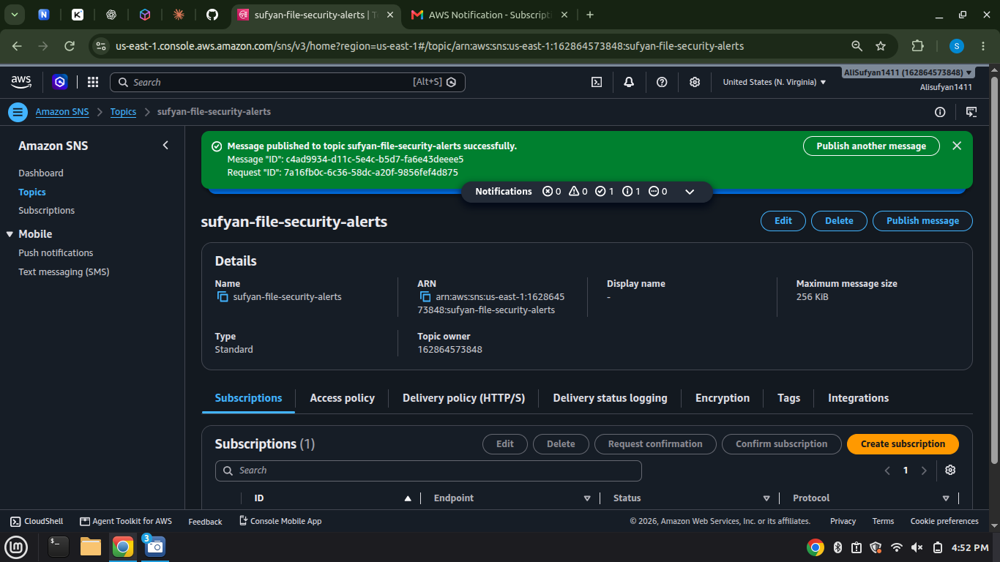
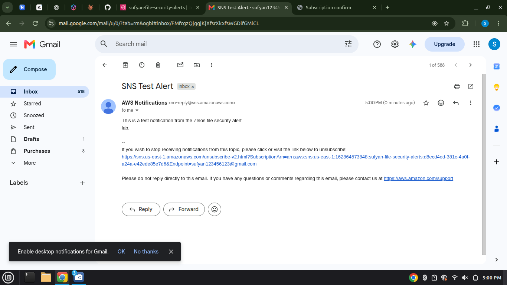
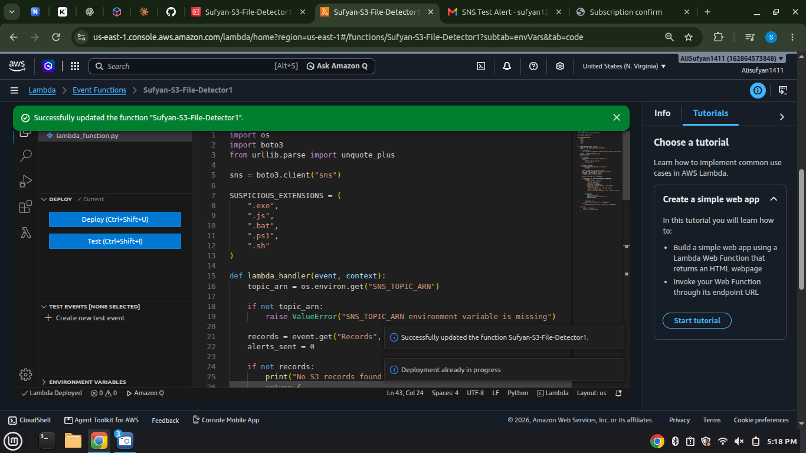
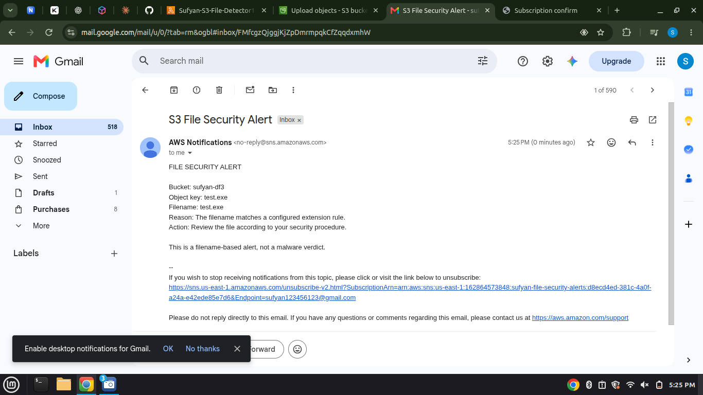
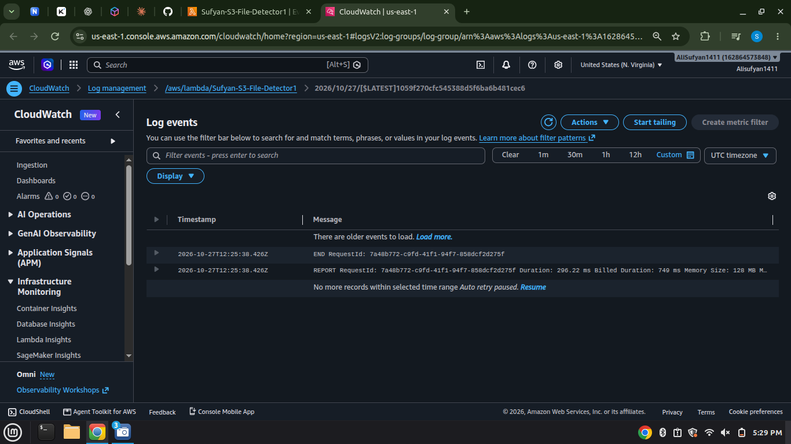

# S3 File Security Alert System (AWS Lambda + SNS)

A beginner-friendly, serverless project built entirely in the AWS Management Console. When a file with a suspicious extension (such as `.exe`) is uploaded to an S3 bucket, a Lambda function detects it and sends an email alert through Amazon SNS.

> **Security limitation:** This project checks **filenames only**. It does not inspect file contents, detect malware, or prove that a file is safe or malicious.

---

## Architecture

```
┌──────────┐  object-created   ┌─────────────┐  publish   ┌───────────┐  email   ┌─────────┐
│ Amazon   │ ────────────────► │ AWS Lambda  │ ─────────► │ Amazon    │ ───────► │ Inbox   │
│ S3       │      event        │ (Python)    │            │ SNS topic │          │         │
└──────────┘                   └──────┬──────┘            └───────────┘          └─────────┘
                                      │
                                      ▼
                              Amazon CloudWatch Logs
```

**Flow**

1. A file is uploaded to the S3 bucket.
2. S3 sends an object-created event to Lambda.
3. Lambda extracts the filename from the event.
4. Lambda compares the extension against a configured list (`.exe`, `.js`, `.bat`, `.ps1`, `.sh`).
5. If it matches, Lambda publishes a message to an SNS topic.
6. SNS emails the message to the confirmed subscriber.
7. Execution details are written to CloudWatch Logs.

## AWS services used

| Service | Role in the project |
|---|---|
| Amazon S3 | Stores uploaded files and generates events |
| AWS Lambda | Checks the filename and decides if an alert is needed |
| Amazon SNS | Sends the email notification |
| AWS IAM | Grants Lambda permission to publish to the SNS topic only |
| Amazon CloudWatch | Stores execution logs for troubleshooting |

## Resources created

| Resource | Name |
|---|---|
| Region | `us-east-1` (N. Virginia) |
| S3 bucket | `sufyan-df3` |
| Lambda function | `Sufyan-S3-File-Detector1` (Python) |
| SNS topic | `sufyan-file-security-alerts` (Standard) |
| IAM inline policy | `SufyanPublishFileSecurityAlerts` |
| Environment variable | `SNS_TOPIC_ARN` |

---

## Step-by-step walkthrough

### Part A: Prerequisites

#### 1. Create the S3 bucket
Created a bucket named `sufyan-df3` in `us-east-1` with **Block all public access** left on.



#### 2. Create the Lambda function and add the S3 trigger
Created a Python Lambda function from scratch with a basic execution role, then added an S3 trigger on `sufyan-df3` for **all object create events**.



---

### Part B: The lab

#### Step 1: Create the SNS topic
Created a **Standard** topic named `sufyan-file-security-alerts` and copied its ARN for later use.

#### Step 2: Subscribe an email address
Created an **Email** subscription. It starts as *Pending confirmation*:



SNS sends a confirmation email. Clicking **Confirm subscription** activates it:



#### Step 3: Test SNS on its own
Before involving Lambda, published a test message from the SNS console to confirm that email delivery works. The subscription now shows **Confirmed**:



The test email arrived in the inbox:



#### Step 4: Give Lambda permission to publish to SNS
Opened the Lambda execution role in IAM and added an inline policy that allows only `sns:Publish` on the specific topic ARN (no wildcard):

```json
{
  "Version": "2012-10-17",
  "Statement": [
    {
      "Sid": "PublishFileSecurityAlerts",
      "Effect": "Allow",
      "Action": "sns:Publish",
      "Resource": "arn:aws:sns:us-east-1:<ACCOUNT_ID>:sufyan-file-security-alerts"
    }
  ]
}
```



#### Step 5: Add the environment variable
In **Configuration → Environment variables**, added:

| Key | Value |
|---|---|
| `SNS_TOPIC_ARN` | the ARN of the SNS topic |

Keeping the ARN out of the code makes the function easier to maintain.


#### Step 6: Update and deploy the Lambda code

```python
import os
import boto3
from urllib.parse import unquote_plus

sns = boto3.client("sns")

SUSPICIOUS_EXTENSIONS = (
    ".exe",
    ".js",
    ".bat",
    ".ps1",
    ".sh"
)

def lambda_handler(event, context):
    topic_arn = os.environ.get("SNS_TOPIC_ARN")

    if not topic_arn:
        raise ValueError("SNS_TOPIC_ARN environment variable is missing")

    records = event.get("Records", [])
    alerts_sent = 0

    if not records:
        print("No S3 records found in the event.")
        return {
            "status": "No S3 records",
            "alerts_sent": 0
        }

    for record in records:
        if record.get("eventSource") != "aws:s3":
            continue

        bucket = record["s3"]["bucket"]["name"]
        key = unquote_plus(record["s3"]["object"]["key"])
        filename = key.rsplit("/", 1)[-1]
        filename_lower = filename.lower()

        print(f"Checking file: {filename}")

        if filename_lower.endswith(SUSPICIOUS_EXTENSIONS):
            message = (
                "FILE SECURITY ALERT\n\n"
                f"Bucket: {bucket}\n"
                f"Object key: {key}\n"
                f"Filename: {filename}\n"
                "Reason: The filename matches a configured "
                "extension rule.\n"
                "Action: Review the file according to your "
                "security procedure.\n\n"
                "This is a filename-based alert, not a malware verdict."
            )

            sns.publish(
                TopicArn=topic_arn,
                Subject="S3 File Security Alert",
                Message=message
            )

            alerts_sent += 1
            print(f"Alert published for: {filename}")
        else:
            print(f"No extension alert required for: {filename}")

    return {
        "status": "Completed",
        "alerts_sent": alerts_sent
    }
```

How it works:

- `unquote_plus()` decodes URL-encoded S3 object keys (spaces, special characters).
- `filename.lower()` makes the extension check case-insensitive.
- `endswith(SUSPICIOUS_EXTENSIONS)` checks the filename against the tuple of extensions.
- `sns.publish()` sends the alert to the topic, and SNS handles email delivery.



#### Step 7: Confirm the S3 trigger
Verified that S3 is still listed as a trigger on the function for `sufyan-df3`, without adding a second overlapping trigger.

#### Step 8: Test with a suspicious filename
Created a harmless text file, renamed it `test.exe`, and uploaded it to the bucket. An email arrived within seconds:



#### Step 9: Test with a normal filename
Uploaded `notes.txt`. Lambda ran, logged that no alert was required, and no email was sent.


#### Step 10: Check CloudWatch Logs
Opened **Monitor → View CloudWatch logs** to review the execution:

```
Checking file: test.exe
Alert published for: test.exe
Checking file: notes.txt
No extension alert required for: notes.txt
```



---

## Results

- Uploading `test.exe` triggers an email alert.
- Uploading `notes.txt` does not.
- IAM permission is limited to `sns:Publish` on one topic.
- CloudWatch Logs show every decision the function made.

## Troubleshooting

| Problem | What to check |
|---|---|
| No Lambda execution appears | S3 trigger, bucket, Region, event type |
| `AccessDenied` / `AuthorizationError` | Inline policy ARN and that it is attached to the correct role |
| `SNS_TOPIC_ARN environment variable is missing` | Variable name spelling (case-sensitive) |
| Lambda succeeds but no email | Subscription status (must be Confirmed) and spam folder |
| `ResourceNotFound` | Topic ARN and Region |

## Cleanup

1. Delete the test files from the S3 bucket.
2. Delete the SNS subscription and topic.
3. Remove the inline IAM policy.
4. Remove the `SNS_TOPIC_ARN` environment variable if the alert feature is removed.

## What I learned

- How S3 events invoke Lambda without any servers to manage.
- How IAM execution roles grant least-privilege access to other services.
- How SNS topics and email subscriptions work, including the confirmation step.
- How environment variables keep configuration separate from code.
- How to use CloudWatch Logs to verify and debug a function.

## Possible improvements

- Make the extension list configurable through an environment variable.
- Send alerts to multiple subscribers.
- Record alert metadata in DynamoDB.
- Add a real malware-scanning service, or use Amazon GuardDuty for supported threat-detection cases.

## References

- [Process Amazon S3 event notifications with Lambda](https://docs.aws.amazon.com/lambda/latest/dg/with-s3.html)
- [Create an Amazon SNS topic](https://docs.aws.amazon.com/sns/latest/dg/sns-create-topic.html)
- [Amazon SNS email subscriptions](https://docs.aws.amazon.com/sns/latest/dg/sns-email-notifications.html)
- [AWS Lambda execution roles](https://docs.aws.amazon.com/lambda/latest/dg/lambda-intro-execution-role.html)
